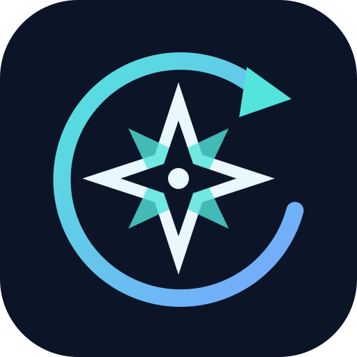

<p align="center"></p>

# Northstar Recovery · avr

[](https://github.com/changfeng0627/northstar-recovery-avr/actions/workflows/validate.yml)

为 **联想 Y70 新一代 XT2611-1 / avr** 整理的独立 Recovery 适配分支。基于 [qingxin94/avr-recovery](https://github.com/qingxin94/avr-recovery) 和 AERA Recovery，记录来源与署名，使用新的 Northstar 界面品牌。完整来源见 [UPSTREAM.md](UPSTREAM.md)。

**当前为实验性 beta。** 原镜像实机可启动但触摸失效；本分支已补入设备驱动、Goodix THP 用户态程序与配置，并完成离线校验。修复候选尚未再次刷入手机，不能据此声称触摸、解密或 Wi-Fi 已修好。

## 下载与状态

- [实验性 Release 与 SHA256SUMS](https://github.com/changfeng0627/northstar-recovery-avr/releases)
- [已处理缺陷与剩余问题](docs/BUGS.md)
- [实机验收、回退和品牌说明](docs/TESTING.md)

| 项目 | 当前状态 |
| --- | --- |
| 设备基线 | XT2611-1 / avr，Android 16，安全补丁 2026-09-05 |
| 内核基线 | 6.12.58-android16-6-gb0a9599c6c01-ab14987696-4k |
| recovery 格式 | Android v4、LZ4 ramdisk、128 MiB、无内置内核 |
| 驱动与依赖 | 当前固件提取的 83 个模块，依赖递归排序，98 个设备资源逐项校验 |
| 触摸 | Goodix THP 内核模块 + odm_tsc + Goodix 库 + 配置，运行目录位于 /tmp |
| 本地验证 | 镜像读回、资源哈希、动态库存在性、AVB 签名/内容哈希、8 项打包测试 |
| 全量源码构建 | 已提供手动 Actions 流程；尚未报告成功构建 |
| 实机修复验收 | 待进行；用户手机保持原 recovery 与原系统 |

## 主要改动

- 修复“写了驱动加载名单，镜像却没有设备驱动”的打包缺口，不再把构建输出绝对路径当作 PRODUCT_COPY_FILES 目标。
- 为 Goodix THP 增加用户态处理程序。将它的触摸工作目录重定向到临时内存，避免要求先解密或写入 userdata。
- 删除实机不存在的触摸/Wi-Fi 节点配置、固定槽位和伪装解锁属性；安全补丁日期与当前固件对齐。
- WLAN 等待增加 30 秒上限，supplicant 配置随镜像提供，临时 socket 目录收紧权限。
- 预编译资源校验 SHA256；镜像生成后重建文件清单，运行 AVB 和资源内容复核；保留源码清单与构建日志。
- 更新 Northstar 图标、启动图形和“关于”页品牌，保留上游版权、接口与归属。

## 构建

仓库只存源码、配置、校验记录和原创图标。设备二进制包放在 Release，不把用户备份分区或个人信息放入 Git。

在 Actions 中选择 **Build Northstar from source → Run workflow**。它下载并校验 `inputs.lock.json` 指定的资源，固定主要上游源码提交，注入 Northstar 品牌和设备资源，再编译 `recoveryimage`。构建结果作为 artifact 提供，不自动冒充通过实机验收的正式 Release。

Linux 本地构建需 Android Recovery 构建依赖、repo、足够磁盘和内存：

```bash
python3 -m pip install -r requirements.txt
python3 tools/download_inputs.py --output inputs
NORTHSTAR_BUILD_ROOT=/path/to/build bash tools/build_source.sh
```

通过现有镜像生成候选版时，使用 `tools/prepare_device.py`、`tools/stage_bundle.py`、`tools/build_candidate.py`。工具只接受已分析基线镜像的固定 SHA256，并校验设备资源；它不是可对任意手机镜像通用重打包的工具。AVB 工具和公开测试密钥由 `tools/fetch_avb.py` 从固定 AOSP 版本获取并校验。

## 验证

```bash
python3 -m unittest discover -s tests -v
python3 tools/validate.py
python3 tools/validate.py --image recovery.img
```

具体刷入步骤须先核对设备和当前槽位、验证备份；请按 [TESTING.md](docs/TESTING.md) 执行。这里不提供默认刷双槽、清除数据或重新锁定 Bootloader 的自动脚本。

## 署名与许可

设备树原作者：**qingxin94**。引擎：**AERA Recovery**，继承 TeamWin / Android Recovery 等上游工作。下游维护：**changfeng0627**。详见 [UPSTREAM.md](UPSTREAM.md)。新增工具和图标使用 [MIT 许可](LICENSE-NORTHSTAR)，原有文件及厂商二进制仍遵循各自权利声明。
